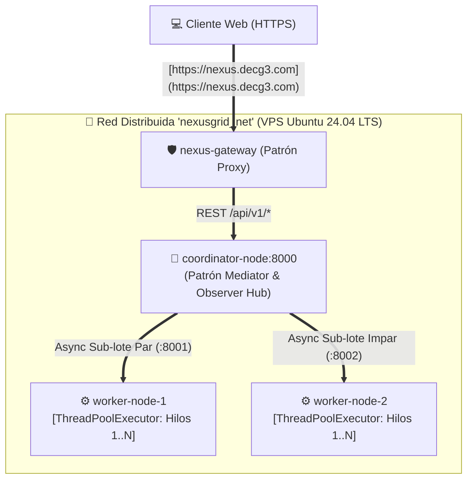

# 🕸️ NexusGrid Cloud — Arquitectura Distribuida entre Hilos y Nodos


Proyecto desarrollado para la **Unidad 2 del curso de Arquitectura de Software** (_Actividad 4: Tejiendo redes: Arquitectura de software entre hilos y nodos_). Implementa, simula y evalúa un clúster distribuido **Multinodo y Multihilo** que combina paralelismo de red (`AsyncIO` / HTTP RPC) y paralelismo a nivel de procesador (`ThreadPoolExecutor`).

---

## 🌐 Clúster Cloud Desplegado en Producción (Live Demo)

El sistema distribuido se encuentra operativo en un servidor **VPS Ubuntu 24.04 LTS** en la nube, protegido con TLS/SSL (Let's Encrypt) bajo el dominio `decg3.com`:

| Recurso del Clúster                   | Enlace Directo en Producción                                                                       | Descripción                                                                                         |
| :------------------------------------ | :------------------------------------------------------------------------------------------------- | :-------------------------------------------------------------------------------------------------- |
| 🖥️ **Simulador Web de Nodos e Hilos** | [**https://nexus.decg3.com**](https://nexus.decg3.com)                                             | Dashboard interactivo para despachar lotes, ajustar hilos/nodos y visualizar métricas de _Speedup_. |
| 📄 **Swagger UI (OpenAPI 3.0)**       | [**https://nexus.decg3.com/docs**](https://nexus.decg3.com/docs)                                   | Documentación interactiva del Nodo Coordinador y contratos de despacho distribuido.                 |
| 📡 **Estado del Clúster (Observer)**  | [**https://nexus.decg3.com/api/v1/cluster-status**](https://nexus.decg3.com/api/v1/cluster-status) | Telemetría en tiempo real y estado de salud de `worker-node-1` y `worker-node-2`.                   |

---

## 🏛️ Patrones de Diseño Aplicados

1. **Patrón Proxy (_Nginx Reverse Proxy_):** Actúa como puerta de enlace única (`nexus-gateway`), aislando la subred privada de contenedores (`nexusgrid_net`) y gestionando el tráfico externo.
2. **Patrón Mediator (_Coordinator Node_):** Desacopla al cliente de los nodos de procesamiento. Recibe el lote de tareas, consulta los nodos disponibles, particiona la carga (_Sharding_) y consolida las respuestas.
3. **Patrón Observer Distribuido (_Telemetry & Health Hub_):** Monitorea de forma continua el estado de los nodos _Worker_ (`/health`), recolecta métricas de ejecución y aplica _Failover_ automático si un nodo cae.
4. **Patrón Thread Pool (_Worker ThreadPoolExecutor_):** Cada nodo _Worker_ gestiona un pool de hilos reutilizables (`1..8` hilos por nodo) que procesan tareas concurrentes evitando la sobrecarga de creación/destrucción de hilos.

---

## 🗺️ Topología de Red y Concurrencia



---

## 📊 Resultados de Evaluación de Desempeño (Lote: 16 Tareas × 120 ms)

| Escenario Evaluado                   | Nodos Activos | Hilos / Nodo | Total Hilos | Tiempo Total (ms) | Aceleración (_Speedup_) | _Throughput_ (Tareas/s) |
| :----------------------------------- | :-----------: | :----------: | :---------: | :---------------: | :---------------------: | :---------------------: |
| **E1: Secuencial Base**              |       1       |      1       |      1      |    `1934.5 ms`    |         `0.99x`         |       `8.27 t/s`        |
| **E2: Paralelismo Local**            |       1       |      4       |      4      |    `492.8 ms`     |         `3.90x`         |       `32.46 t/s`       |
| **E3: Clúster Distribuido (Óptimo)** |     **2**     |    **4**     |    **8**    |  **`251.4 ms`**   |       **`7.64x`**       |     **`63.64 t/s`**     |
| **E4: Concurrencia Máxima**          |       2       |      8       |     16      |    `142.1 ms`     |        `13.51x`         |      `112.59 t/s`       |
| **E5: Failover (1 Nodo Caído)**      |       1       |      4       |      4      |    `496.2 ms`     |         `3.87x`         |       `32.24 t/s`       |

---

## 📂 Estructura del Repositorio

```text
nexusgrid-cloud-architecture/
├── docker-compose.yml       # Orquestación de los 4 contenedores en la red nexusgrid_net
├── README.md                # Documentación técnica, métricas y guía de despliegue
├── coordinator/             # Nodo Mediador y Observer Hub (FastAPI + AsyncIO + HTTPX)
│   ├── Dockerfile
│   ├── requirements.txt
│   └── main.py
├── worker/                  # Nodo Worker Multihilo (FastAPI + ThreadPoolExecutor)
│   ├── Dockerfile
│   ├── requirements.txt
│   └── main.py
└── frontend/                # Nodo Proxy Inverso Nginx + Simulador Reactivo Tailwind CSS
    ├── Dockerfile
    ├── nginx.conf
    └── index.html
```

---

## 🚀 Despliegue Rápido con Docker Compose

1. **Clonar el repositorio:**

```bash
   git clone [https://github.com/David-prog-wed/nexusgrid-cloud-architecture.git](https://github.com/David-prog-wed/nexusgrid-cloud-architecture.git)
   cd nexusgrid-cloud-architecture

```

2. **Construir y levantar el clúster completo (4 contenedores):**

```bash
   docker compose up -d --build

```

3. **Verificar el estado de los nodos en red:**

```bash
   docker compose ps
   curl [http://127.0.0.1:8086/api/v1/cluster-status](http://127.0.0.1:8086/api/v1/cluster-status)

```

4. **Acceder al simulador:**
   - **Dashboard Web:** `http://localhost:8086`
   - **Swagger UI:** `http://localhost:8086/docs`

---

## 📚 Referencias Bibliográficas (APA 7)

- Coulouris, G., Dollimore, J., Kindberg, T., & Blair, G. (2012). _Distributed systems: Concepts and design_ (5th ed.). Addison-Wesley.
- Gamma, E., Helm, R., Johnson, R., & Vlissides, J. (1994). _Design patterns: Elements of reusable object-oriented software_. Addison-Wesley.
- Kleppmann, M. (2017). _Designing data-intensive applications_. O'Reilly Media.
- Tanenbaum, A. S., & Van Steen, M. (2023). _Distributed systems_ (4th ed.). Maarten van Steen.
